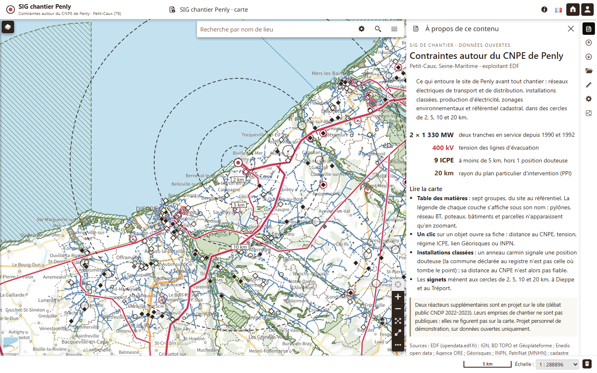
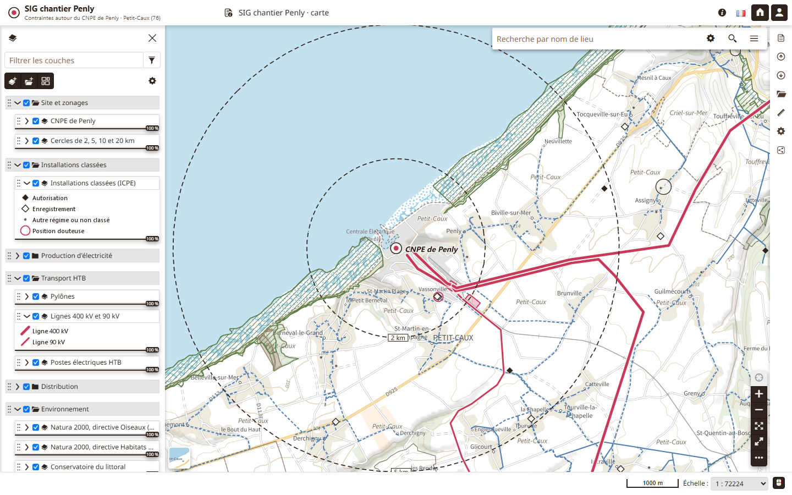
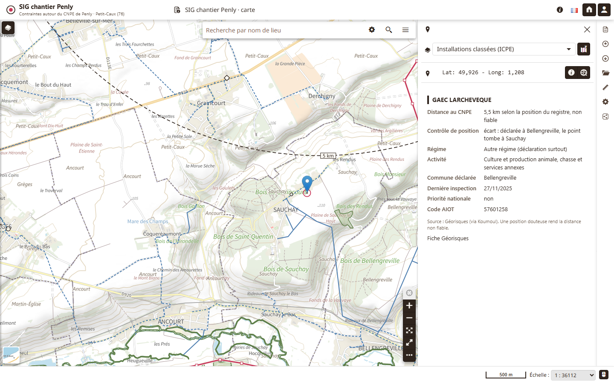

# Publication MapStore

Les couches du SIG chantier Penly publiées comme dans un SIG d'entreprise : base **PostGIS**, services **GeoServer**
(WMS, WFS, styles SLD), puis carte et application dédiée dans **MapStore**.



## Ce qui est publié

- **19 couches** en Lambert-93 dans le schéma `carto` de la base `penly_carto`, reprojetées par GeoServer pour MapStore.
- **19 styles SLD** écrits en Python (`styles.py`) avec la charte de la carte web : encre sépia, carmin pour le
  transport HTB, bleu pour la distribution, vert pour l'environnement. Les couches denses (pylônes, réseau BT,
  poteaux, bâtiments, parcelles) n'apparaissent qu'à partir d'une échelle donnée ; les légendes reprennent les
  libellés des règles.
- **Une carte** en sept groupes (site, ICPE, production, HTB, distribution, environnement, référentiel), avec fonds
  IGN de la Géoplateforme, signets sur les cercles de 2, 5, 10 et 20 km, fiche HTML au clic sur chaque objet, fiche
  de présentation et vignette.
- **Une application dédiée** (contexte MapStore) : bandeau et couleurs du projet, légendes dans la table des
  matières, outils inutiles ici retirés (impression, 3D, annotations, enregistrement).

Les ressources sont en lecture publique ; relancer un script met à jour sans dupliquer.

| Table des matières et légendes | Fiche d'une ICPE à la position douteuse |
|---|---|
|  |  |

La fiche de droite montre le contrôle qualité des ICPE : l'établissement est déclaré à Bellengreville mais son point
tombe à Sauchay, sa distance au CNPE est donc marquée non fiable et le symbole est cerclé de carmin.

## Prérequis

- Une pile MapStore locale : MapStore, GeoServer et nginx sous Docker (http://localhost:8097), PostgreSQL 15 avec
  PostGIS sur la machine, joignable depuis les conteneurs par `host.docker.internal`. Les comptes admin sont lus dans
  le `.env` de cette pile, dont le dossier est donné par `MAPSTORE_PILE`.
- QGIS 3.34 (pour `ogr2ogr`), Python 3.11 ou plus (bibliothèque standard seulement), Node 22 et Edge ou Chrome pour
  les captures.
- Le GeoPackage `02_donnees/penly_sig.gpkg`, reconstruit par `scripts/02_construire_gpkg.py`.

Copier `.env.example` en `.env` et renseigner `MAPSTORE_PILE`. Aucun mot de passe n'est écrit dans les scripts
ni affiché : le rôle PostgreSQL `penly` reçoit un mot de passe tiré au hasard, rangé dans `.env` (ignoré par git).

## Rejouer la chaîne

Depuis la racine du dépôt :

```powershell
python 05_mapstore\00_creer_base.py
```

```powershell
python 05_mapstore\01_charger_postgis.py
```

```powershell
python 05_mapstore\02_publier_geoserver.py
```

```powershell
python 05_mapstore\03_publier_mapstore.py
```

```powershell
node 05_mapstore\captures.mjs
```

| Fichier | Rôle |
|---|---|
| `00_creer_base.py`, `sql/creer_base.sql` | rôle `penly`, base `penly_carto` (PostGIS, unaccent), schémas `brut` et `carto` ; à lancer une fois |
| `01_charger_postgis.py` | importe 22 couches du GeoPackage dans `brut` (ogr2ogr, 2D), puis lance `sql/carto.sql` |
| `sql/carto.sql` | tables de la carte : libellés français, longueurs et distances au CNPE en texte, tension HTB, réseaux aérien et souterrain réunis, production regroupée par commune, contrôle de position des ICPE (commune déclarée contre commune du point) ; clé primaire, index spatial |
| `02_publier_geoserver.py` | espace de travail `penly`, entrepôt PostGIS `carto`, styles SLD, couches avec titre, résumé et attribution |
| `styles.py` | les 19 styles SLD (palette, échelles d'affichage, étiquettes encadrées des cercles) |
| `catalogue.py` | une seule liste des couches pour GeoServer et MapStore : titre, résumé, groupe, visibilité, fiche au clic |
| `03_publier_mapstore.py` | carte, fiche de présentation, vignette et application dans MapStore (API GeoStore), droits de lecture publics, `adresses.json` |
| `carte.py`, `application.py`, `textes.py`, `ressources.py` | configuration de la carte, de l'application, texte de présentation, accès à l'API GeoStore |
| `captures.mjs` | captures d'écran de l'application (`images/`), par Edge ou Chrome sans fenêtre |

Adresses une fois publié (les identifiants dépendent de l'instance, `python 05_mapstore\03_publier_mapstore.py adresses`
les affiche) : application `http://localhost:8097/mapstore/#/context/sig-chantier-penly/<id>`, carte
`http://localhost:8097/mapstore/#/viewer/<id>`.
