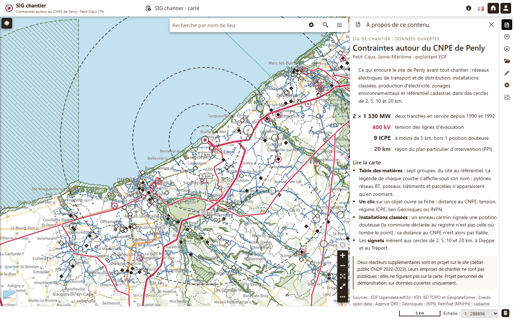
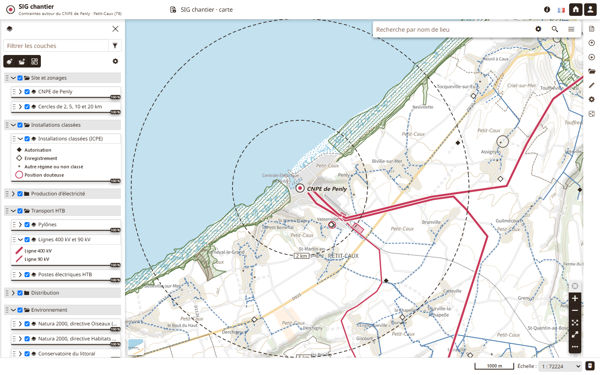
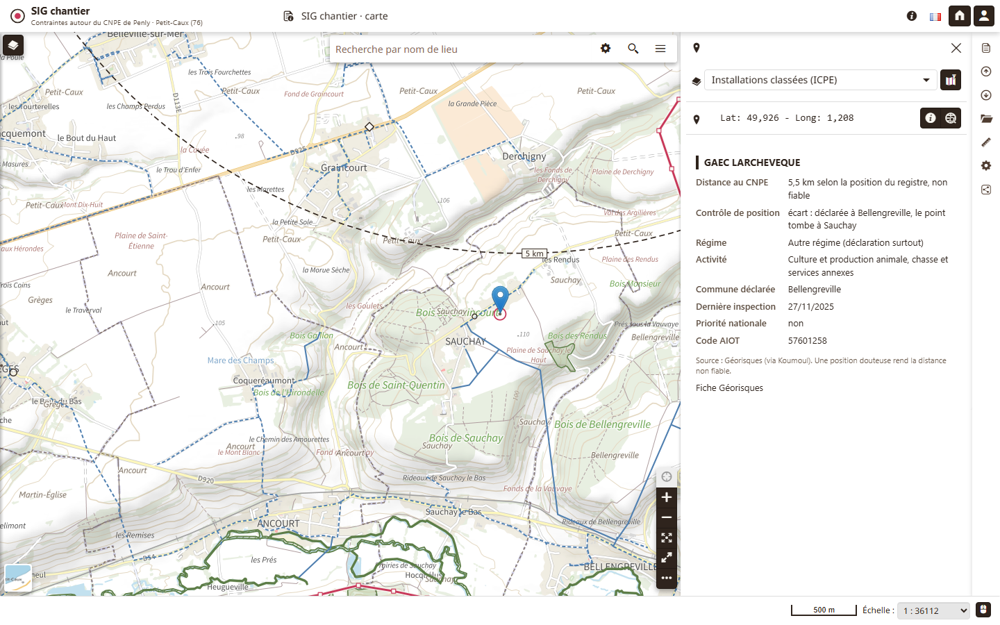
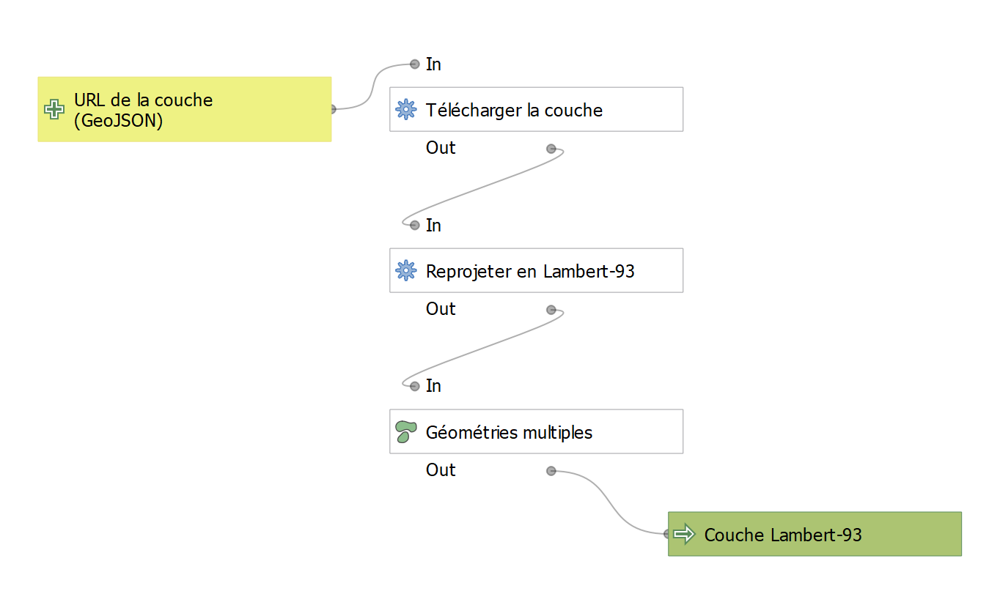
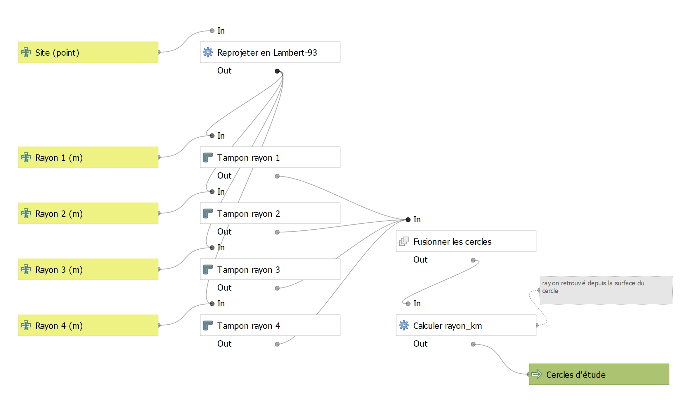
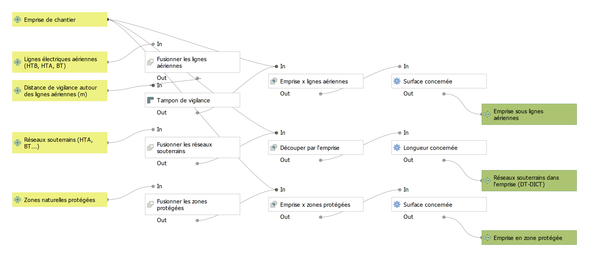
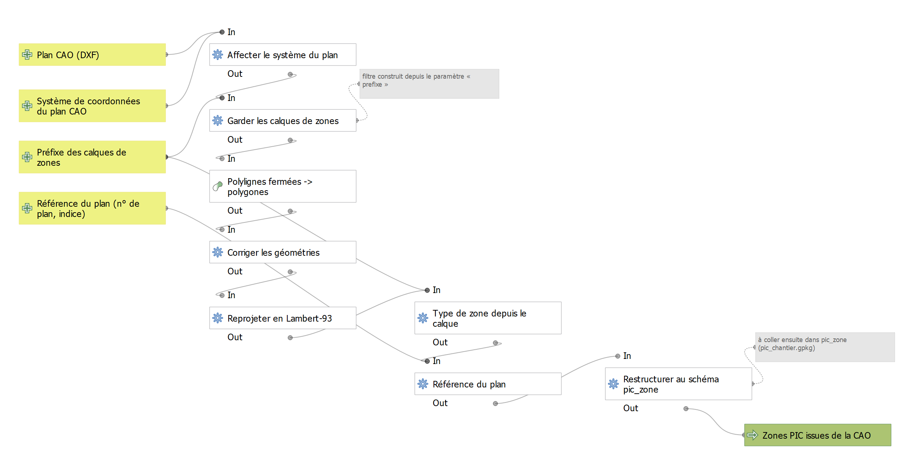

# SIG chantier : démonstrateur open data

Un SIG de chantier construit uniquement avec des **données ouvertes et gratuites**, autour du centre nucléaire de
production d'électricité (CNPE) de Penly, à Petit-Caux (Seine-Maritime), où deux nouveaux réacteurs sont en projet.

Le dépôt reproduit la chaîne de travail complète d'un SIG de chantier : collecte et contrôle des données, base
structurée en Lambert-93, modèle de données du plan d'installation de chantier (PIC), conversion CAO vers SIG,
traitements automatisés (Python et Modeleur graphique QGIS), plan imprimable, carte web et publication
PostGIS / GeoServer / MapStore.

> Les emprises du futur chantier ne sont pas publiques : elles ne figurent nulle part dans ce projet.
> Le fichier `04_cao/exemple_fictif_PIC.dxf` est un plan **fictif** qui sert uniquement à tester la conversion CAO.
> Projet personnel, sans lien avec les producteurs de données, cités uniquement comme sources.

## Carte web

**Carte en ligne : <https://jauresmas.github.io/sig-chantier/>**

`docs/` contient une carte web autonome (HTML, CSS et JavaScript, sans compilation) publiée par GitHub Pages.

- **Univers « plan cadastral »** : encre sépia, lavis carmin pour le transport HTB, bleu pour la distribution, vert
  pour l'environnement, sur fonds IGN (plan désaturé, photographies aériennes, plan cadastral).
- **Fiche du site** : puissance installée, tension d'évacuation, ICPE à moins de 5 km, rayon du PPI.
- **Couches groupées** avec légende dessinée comme sur la carte, source, et nombre d'objets dans la vue sur le total.
- **Fiche d'objet** dans le panneau, avec la distance au CNPE calculée en Lambert-93 et les autres objets au même endroit.
- **Tableau d'assemblage** : un encart qui suit la vue et ouvre les planches 2, 5, 10 et 20 km toujours au même
  cadrage, ou une commune au clic.
- **Mesure de distance**, **recherche d'adresse** (géocodeur de la Géoplateforme), coordonnées Lambert-93 et échelle.
- **Contrôle qualité visible** : les ICPE dont la position tombe hors de la commune déclarée sont cerclées de carmin
  (21 sur 315 à l'extraction du 21/11/2026).

Pour l'ouvrir en local (les données sont chargées par `fetch`, il faut un serveur web) :

```powershell
python -m http.server 8000 --directory docs
```

puis http://localhost:8000.

## Publication MapStore

Les mêmes couches publiées comme dans un SIG d'entreprise : base **PostGIS**, services **GeoServer** (WMS, WFS,
19 styles SLD écrits en Python) et application dédiée dans **MapStore**, avec table des matières légendée, fiches au
clic, signets sur les cercles d'étude et fonds IGN. Chaîne rejouable et détail dans [`05_mapstore/`](05_mapstore/README.md).



| Table des matières et légendes | Fiche d'une ICPE à la position douteuse |
|---|---|
|  |  |

## Arborescence

```
sig-chantier/
├── README.md
├── PRODUCT.md                  contexte produit de la carte web
├── 00_docs/                    documentation ; modeles/ : images des 4 modèles du Modeleur
├── 01_donnees_brutes/          téléchargements bruts par source (non versionnés) + manifeste.json (URL, date, licence)
├── 02_donnees/
│   ├── sig_chantier.gpkg       29 couches + 5 tables, Lambert-93 (non versionné, reconstruit par le script 02)
│   └── pic_chantier.gpkg       modèle vide du PIC : pic_zone, pic_acces, pic_equipement
├── 03_qgis/
│   ├── sig_chantier.qgz        projet QGIS (chemins relatifs, styles, formulaires PIC, fonds IGN, mise en page A3)
│   └── modeles/                4 modèles du Modeleur graphique (.model3)
├── 04_cao/                     plans CAO (DXF) à intégrer, dont l'exemple fictif
├── 05_mapstore/                publication PostGIS, GeoServer et MapStore ; images/ : captures de l'application
├── 06_exports/                 plan_situation_A3.pdf / .png
├── docs/                       carte web (GitHub Pages) et ses données GeoJSON
└── scripts/                    chaîne de traitement Python (rejouable)
```

## Rejouer la chaîne

Depuis la racine du dépôt, dans PowerShell (QGIS 3.34 LTR installé) :

```powershell
python scripts\01_telecharger_donnees.py
```

```powershell
& "C:\Program Files\QGIS 3.34.12\bin\python-qgis-ltr.bat" scripts\02_construire_gpkg.py
```

```powershell
& "C:\Program Files\QGIS 3.34.12\bin\python-qgis-ltr.bat" scripts\03_projet_qgis.py
```

```powershell
& "C:\Program Files\QGIS 3.34.12\bin\python-qgis-ltr.bat" scripts\04_creer_modeles.py
```

```powershell
& "C:\Program Files\QGIS 3.34.12\bin\python-qgis-ltr.bat" scripts\05_exporter_web.py
```

```powershell
& "C:\Program Files\QGIS 3.34.12\bin\python-qgis-ltr.bat" scripts\06_capturer_modeles.py
```

| Script | Rôle |
|---|---|
| `01_telecharger_donnees.py` | interroge les API (Data Fair EDF / Enedis / ORE / Koumoul, WFS Géoplateforme, cadastre Etalab) sur l'emprise de 20 km ; corrige l'encodage des données EDF (« Nucléaire » devient « Nucléaire ») ; écrit le manifeste |
| `02_construire_gpkg.py` | reprojette tout en Lambert-93, fusionne (ZNIEFF terre et mer), nomme les couches par thème, crée les cercles 2 / 5 / 10 / 20 km et le modèle PIC (jamais écrasé s'il existe) |
| `03_projet_qgis.py` | groupes, symbologie (HTB par tension, ICPE par régime…), formulaires PIC avec listes de valeurs, fonds IGN, mise en page A3 et export PDF / PNG ; lançable aussi dans la console Python de QGIS |
| `04_creer_modeles.py` | génère les 4 modèles du Modeleur, un DXF d'exemple fictif, puis teste chaque modèle sur les données |
| `05_exporter_web.py` | exporte les couches de la carte web en GeoJSON WGS84 allégé (champs renommés, géométries simplifiées et découpées), calcule la distance de chaque objet au CNPE et le bilan par anneau, contrôle la position des ICPE, dérive un masque de mer (emprise des communes moins leur union) pour le fond orthophoto |
| `06_capturer_modeles.py` | rend chaque modèle du Modeleur en image PNG (comme « Exporter en image ») dans `00_docs/modeles/`, QGIS fermé |

## Données

Emprise : carré englobant le cercle de 20 km autour du CNPE (lon 0,93 à 1,49 / lat 49,80 à 50,16) ; bâti et
végétation sur environ 10 × 10 km. Toutes les sources sont gratuites, sous **Licence Ouverte Etalab 2.0**.
Détail et URL : `01_donnees_brutes/manifeste.json`.

| Thème | Couches (`sig_chantier.gpkg`) | Source | Objets |
|---|---|---|---|
| Production | `prod_centrales_nucleaires` / `_hydrauliques` / `_thermiques` (France entière) | EDF (opendata.edf.fr) | 57 / 51 / 19 |
| Production | `prod_registre_installations` | Agence ORE (RTE, Enedis, EDF SEI, ELD) | 98 |
| Réseau HTB | `res_htb_lignes` (400 et 90 kV), `res_htb_postes`, `res_htb_pylones` | IGN BD TOPO (gestionnaire RTE) | 36 / 10 / 442 |
| Réseau Enedis | `res_hta_aerien`, `res_hta_souterrain`, `res_bt_aerien`, `res_bt_souterrain`, `res_postes_hta_bt`, `res_poteaux_hta_bt` | Enedis (opendata.enedis.fr) | 1 278 / 3 813 / 4 354 / 15 551 / 1 845 / 9 089 |
| Environnement | `env_znieff1`, `env_znieff2`, `env_natura2000_zsc_sic`, `env_natura2000_zps`, `env_conservatoire_littoral` | PatriNat (WFS Géoplateforme) | 96 / 16 / 9 / 1 / 7 |
| Risques | `env_icpe` | Géorisques (via Koumoul) | 315 |
| Référentiel | `ref_communes`, `ref_routes`, `ref_voies_ferrees`, `ref_cours_eau`, `ref_surfaces_eau`, `ref_zones_activite`, `ref_batiments`, `ref_vegetation`, `ref_haies` | IGN BD TOPO V3 | 114 … 29 264 |
| Foncier | `ref_parcelles_petit_caux` | DGFiP / Etalab | 10 153 |
| Zonages | `zon_cnpe`, `zon_cercles` | calculés | 1 / 4 |
| Tables EDF | `tab_indisponibilites` (en cours), `tab_indisponibilites_hist` (depuis 2015), `tab_historique_productions` (depuis 1948), `tab_disponibilite_parc_nucleaire`, `tab_seuils_rejets_thermiques` | EDF | 615 / 7 576 / 217 / 24 / 51 |

Fonds de plan (flux, rien à télécharger) : Plan IGN v2, orthophotographie, ombrage du relief, cadastre (Géoplateforme IGN).

Points d'attention relevés pendant la collecte :
- **RTE** ne publie plus la géométrie de ses lignes sur ODRÉ (attributs seulement) : les tracés HTB viennent de la BD TOPO.
- Les données **Enedis** apparaissent sur le portail EDF mais sont servies par `opendata.enedis.fr`.
- Le portail EDF a quitté Opendatasoft pour Data Fair : l'ancienne API `/api/explore/v2.1` répond 410.
- Le **registre ORE agrégé** place chaque installation au centre de sa commune : la carte web les regroupe donc par
  commune au lieu d'afficher des points superposés qui laisseraient croire à une position précise.
- **ICPE** : 21 établissements sur 315 sont positionnés hors de leur commune déclarée (géocodage par défaut, fusion
  de communes) ; ils sont signalés dans la carte web.

## Modèle de données du PIC (`pic_chantier.gpkg`)

| Couche | Géométrie | Champ « type » (liste de valeurs dans QGIS) |
|---|---|---|
| `pic_zone` | multipolygone | base_vie, stockage, prefabrication, parking, zone_travaux, plateforme_levage, deblais_remblais, securite, environnement, autre |
| `pic_acces` | multiligne | route_chantier, piste, pieton, convoi, secours |
| `pic_equipement` | point | grue_tour, grue_mobile, centrale_beton, bungalow, poste_garde, poste_elec, eau_incendie, bassin, autre |

Champs communs : `lot` (GCP, INFRA, OPC, LOG, SECU, ENV, ING), `phase` (P0 à P4), `statut` (projet, valide, actif, libere),
`date_debut`, `date_fin`, `source` (CAO, BIM, TERRAIN, DRONE, SIG), `ref_document`, `auteur`, `date_maj`, `commentaire`.
Dans QGIS : type, lot et statut obligatoires ; auteur, date de mise à jour, statut et source remplis par défaut.

## Modèles du Modeleur graphique (`03_qgis/modeles/`)

Ils sont aussi copiés dans la boîte à outils du profil QGIS : *Boîte à outils de traitements > Modèles > SIG chantier*.

| Modèle | Entrées | Sorties | Test sur les données |
|---|---|---|---|
| 01 · Intégrer une couche open data | URL GeoJSON (API ou WFS) | couche en Lambert-93, multi-géométries | 23 postes HTA/BT téléchargés |
| 02 · Zonages d'étude autour d'un site | point + 4 rayons (2, 5, 10, 20 km par défaut) | cercles avec `rayon_km` | 4 cercles (2 / 5 / 10 / 20) |
| 03 · Contraintes d'une emprise de chantier | emprise, lignes aériennes, distance de vigilance, réseaux souterrains, zones protégées | emprise sous lignes aériennes, réseaux souterrains à déclarer (DT-DICT), emprise en zone protégée | sur le cercle de 2 km : 9 / 244 / 7 objets |
| 04 · Conversion CAO (DXF) vers zones du PIC | DXF, SCR du plan, préfixe de calque, référence du plan | polygones au schéma `pic_zone` | 4 zones typées depuis le DXF fictif |

Les modèles tels qu'ils s'affichent dans le Modeleur graphique (entrées en jaune, sorties en vert) :

### 01 · Intégrer une couche open data



### 02 · Zonages d'étude autour d'un site



### 03 · Contraintes d'une emprise de chantier



### 04 · Conversion CAO (DXF) vers zones du PIC



Convention CAO : les zones sont des polylignes fermées sur des calques `PIC_ZONE_<TYPE>` (ex. `PIC_ZONE_BASE_VIE`) ;
le suffixe devient le champ `type_zone`. Le résultat se colle ensuite dans `pic_zone`.

## Étapes suivantes

1. **Saisir un PIC** dans `pic_chantier.gpkg` (formulaires prêts) ou l'importer depuis un DXF avec le modèle 04,
   puis le publier dans MapStore avec les autres couches.
2. **Contrôle qualité** : fiche de contrôle par couche (géométries, champs obligatoires, cohérence avec les listes de valeurs).
3. **Cas d'usage** : itinéraires de convois sur `ref_routes`, analyse des contraintes environnementales, suivi des
   indisponibilités de Penly 1 et 2 (tables EDF) dans un tableau de bord.

## Sources et licence des données

EDF, Enedis, Agence ORE, IGN, PatriNat (OFB, MNHN, CNRS, IRD), Géorisques, DGFiP / Etalab : données publiées sous
Licence Ouverte Etalab 2.0, extraites le 21/11/2026. Fonds de plan : IGN, Géoplateforme.
